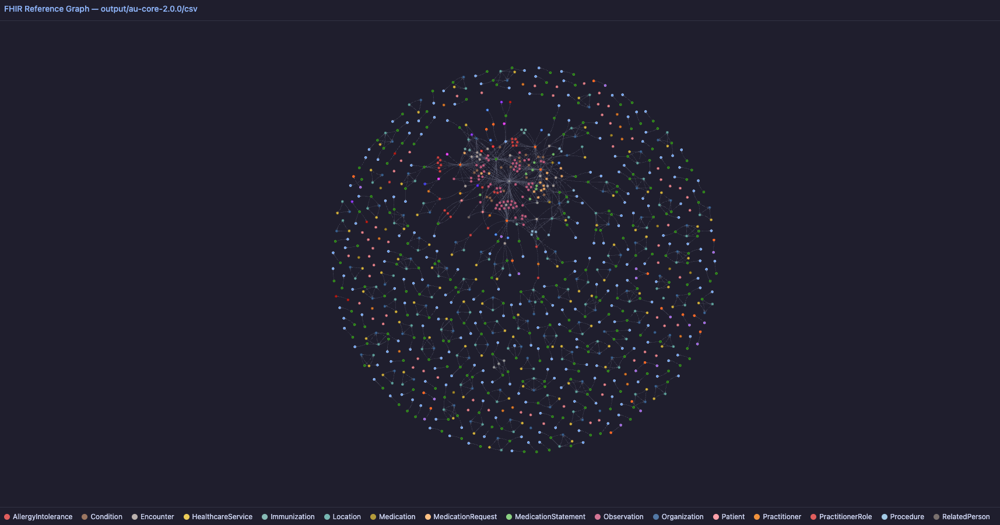

# fhirviz

[](https://github.com/steveswinsburg/fhirviz/actions/workflows/ci.yml)

Interactive reference graph visualiser for FHIR resources.

Reads a directory of `.ndjson` or `.json` FHIR files and renders a force-directed network of resource references as an HTML file.

For very large datasets, the generated HTML now opens in an overview mode instead of trying to render every node at once. Use the search box to explore a local neighborhood around a resource without crashing the browser.



## Usage

After the package is published to npm, run it without a global install:

```sh
npx fhirviz path/to/fhir/files
```

The graph is written to `graph.html` inside the same directory. Open it in any browser.
To process FHIR files in the current directory, use `npx fhirviz .`.
Running the command without arguments displays help.

To install the command globally instead:

```sh
npm install --global fhirviz
fhirviz path/to/fhir/files
```

For smaller datasets, the full graph is shown immediately. For larger datasets, the page starts with a resource-type summary and lets you expand a selected node's neighborhood at configurable depth and size.

## Input formats

- **NDJSON** - one resource per line (`.ndjson`)
- **JSON** - single resource or FHIR Bundle (`.json`)

Both formats can coexist in the same directory.

## CLI

`<path>`
Path to the directory containing FHIR output files. Use `.` to process the current directory. The previous `--dir <path>` form is also supported.

## Requirements

Node.js 22 or newer.

The generated graph loads vis-network from a CDN, so a network connection is required when viewing it.

## Development

```sh
npm ci
npm test
npm link
```

## License

This project is licensed under the Apache License 2.0 - see the [LICENSE](LICENSE) file for details.

---

**Made with ❤️ for the FHIR community**
