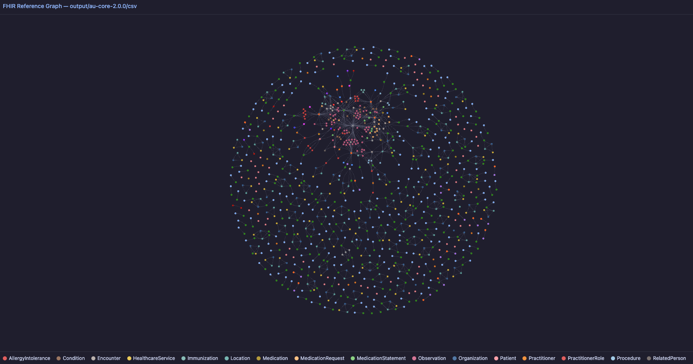

<p align="center">
  
</p>


# fhirviz

Interactive reference graph visualiser for FHIR resources.

[](https://github.com/steveswinsburg/fhirviz/actions/workflows/ci.yml)
[](https://www.npmjs.com/package/fhirviz)
[](LICENSE)

## How it works

Reads a directory of `.ndjson` or `.json` FHIR files and renders a directed network of resource references as an HTML file.

For smaller datasets, the full graph is shown immediately. For larger datasets, the page starts with a resource-type summary and lets you expand a selected node's neighborhood at configurable depth and size.



## Install

Global install:

```bash
npm install -g fhirviz
```

Or run without installing via `npx`:

```bash
npx fhirviz path/to/fhir/resources
```

The graph is written to `graph.html` inside the same directory. Open it in any browser. 

## FHIR resource formats

- **NDJSON** - one resource per line (`.ndjson`)
- **JSON** - single resource or FHIR Bundle (`.json`)

Both formats can coexist in the same directory.

## Usage

```bash
fhirviz path/to/fhir/resources
```

Provide the path to the directory containing FHIR resources. Use `.` to process the current directory. 

`--dir` 
The path to the FHIR directory containing FHIR resources. This is kept as backwards compatibility with fhirviz 1.0.0.

`--open`
Open the generated `graph.html` in the default browser after it's written.

## Requirements

Node.js 22 or newer.

The generated graph loads vis-network from a CDN, so a network connection is required when viewing it.

## Development

```sh
npm install
npm test
npm link
```

---

Made with ❤️ for the FHIR community
